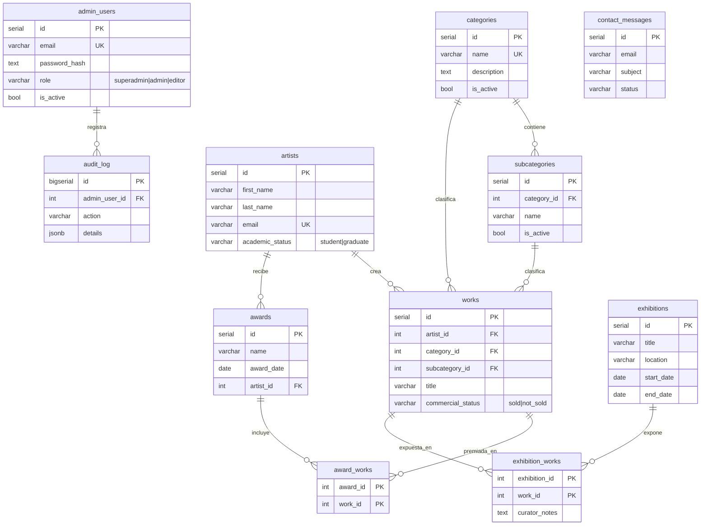

# Arquitectura del Repositorio Universitario de Obras

Responsable: **Desarrollador 1 — Arquitectura, base de datos y autenticación**.

## 1. Vista general

```text
┌──────────────────────────┐   HTTPS + JSON    ┌────────────────────────────┐    SQL    ┌──────────────┐
│ Frontend (React + Vite)  │ ───────────────▶  │ API REST (Node + Express)  │ ───────▶  │ PostgreSQL   │
│ panel admin / sitio      │  Authorization:   │ /api/*                     │   (pg)    │ 14+          │
│ público                  │  Bearer <JWT>     │ routes → services → db     │           │              │
└──────────────────────────┘                   └────────────────────────────┘           └──────────────┘
```

- **Monorepo** con dos paquetes independientes: `backend/` (API) y `frontend/` (SPA).
- **API sin estado** con JWT: cualquier réplica puede atender cualquier petición.
- **PostgreSQL** es la fuente única de datos; la integridad se garantiza con claves foráneas y `CHECK`, no solo en el código.

## 2. Capas del backend

```text
backend/
  sql/                 Migraciones numeradas (001_, 002_, 003_ …). Se aplican en orden.
  src/
    config/env.js      Lectura y validación de variables de entorno.
    db/pool.js         Pool de conexiones, query() y withTransaction().
    db/migrate.js      Ejecuta migraciones pendientes (tabla schema_migrations).
    db/seedAdmin.js    Crea el primer superadministrador desde .env.
    auth/              permissions.js (roles → permisos), password.js (scrypt), tokens.js (JWT).
    middleware/        auth.js (authenticate, requirePermission, protectWrites, protectAll),
                       rateLimit.js, errorHandler.js.
    routes/            Solo HTTP: leer req, llamar al servicio, responder.
    services/          Reglas de negocio y SQL. No conocen Express.
    validators/        Validaciones reutilizables que lanzan HttpError(400).
    utils/httpError.js HttpError + asyncHandler.
  test/                node:test (npm test).
```

Regla: **routes → services → db**. Una ruta nunca escribe SQL; un servicio nunca usa `req`/`res`.

## 3. Modelo de datos



| Relación | Regla | Motivo |
|---|---|---|
| categoría → subcategorías | `ON DELETE RESTRICT` | No perder clasificaciones con datos asociados; se desactivan con `is_active`. |
| obra → (subcategoría, categoría) | FK compuesta a `subcategories(id, category_id)` | La subcategoría de una obra debe pertenecer a su categoría. |
| artista → obras / premios | `RESTRICT` | Un estudiante que se gradúa conserva su id y su historial. |
| premio → obras premiadas | `CASCADE` al borrar el premio | La tabla puente no tiene sentido sin el premio. |
| exposición → obras | `CASCADE` al borrar la exposición, `RESTRICT` al borrar la obra | No borrar obras que forman parte de una muestra. |
| admin → auditoría | `SET NULL` | El registro histórico se conserva aunque se elimine la cuenta. |

**Estudiantes y egresados** se modelan en `artists.academic_status`; no hay tabla separada.

### Migraciones

| Archivo | Módulo | Contenido |
|---|---|---|
| `001_init.sql` | Categorías y artistas | categories, subcategories, artists, works (contrato mínimo) |
| `002_special_modules.sql` | Módulos especiales (rama `feature/modulos-especiales`) | awards, award_works, exhibitions, exhibition_works, contact_messages, estado comercial |
| `003_auth.sql` | Autenticación | admin_users, audit_log |

Reglas para el equipo:
1. **Nunca editar** una migración ya integrada en `main`; crear un archivo nuevo con el siguiente número.
2. Usar `IF NOT EXISTS` / bloques `DO $$` para que sean idempotentes.
3. Ejecutar con `npm run db:migrate` (registra lo aplicado en `schema_migrations`).

> Nota: se corrigió un error de `001_init.sql`: la restricción `UNIQUE (id, category_id)` estaba en `categories` (donde no existe `category_id`) y debía estar en `subcategories`. Sin esa corrección el script no se ejecuta.

## 4. Autenticación y autorización

- **Login** `POST /api/auth/login` → `{ token, user }`. Contraseñas con **scrypt** + sal aleatoria (`node:crypto`), comparación en tiempo constante.
- **JWT HS256** firmado con `JWT_SECRET`, expira según `JWT_EXPIRES_IN` (8 h por defecto). Payload: `sub`, `role`, `name`.
- **Bloqueo por fuerza bruta**: 5 intentos fallidos por IP+correo en 15 min → `429`.
- **Mensaje genérico** ante correo inexistente o contraseña errónea (no se enumeran cuentas).
- **Sin credenciales por defecto**: el primer superadministrador se crea con `npm run db:seed-admin` desde variables de entorno.
- **Auditoría** de inicios de sesión y gestión de usuarios en `audit_log`.

### Roles y permisos

| Permiso | Uso | superadmin | admin | editor |
|---|---|:-:|:-:|:-:|
| `catalog:write` | Categorías, subcategorías, artistas | ✔ | ✔ | ✔ |
| `works:write` | Obras, multimedia, estado comercial | ✔ | ✔ | ✔ |
| `events:write` | Premios y exposiciones | ✔ | ✔ | ✔ |
| `messages:manage` | Bandeja de contacto | ✔ | ✔ | |
| `audit:read` | Registro de auditoría | ✔ | ✔ | |
| `users:manage` | Cuentas de administradores | ✔ | | |

Definidos en `backend/src/auth/permissions.js` (fuente de verdad). El frontend recibe la lista en `/api/auth/me` y solo **oculta** opciones; la decisión real siempre la toma la API.

Protecciones adicionales: un superadmin no puede desactivarse ni cambiarse el rol a sí mismo, y siempre debe quedar al menos un superadmin activo.

### Protección de rutas

```js
import { PERMISSIONS } from './auth/permissions.js';
import { protectAll, protectWrites } from './middleware/auth.js';

app.use('/api/categories', protectWrites(PERMISSIONS.CATALOG_WRITE), categories); // GET público
app.use('/api/admin-users', protectAll(PERMISSIONS.USERS_MANAGE), adminUsers);      // todo protegido
```

La pantalla de login y el manejo de sesión en el frontend corresponden al panel administrativo (Desarrollador 4). Guía de integración: [docs/INTEGRACION_FRONTEND.md](INTEGRACION_FRONTEND.md).

### Limitaciones conocidas

- Al ser JWT sin estado, desactivar una cuenta o cambiar su rol surte efecto cuando el token expira (máx. `JWT_EXPIRES_IN`). Si se requiere revocación inmediata, consultar `is_active` en `authenticate` o reducir la expiración.
- El limitador de intentos vive en memoria: con varias réplicas debe moverse a un almacén compartido.

## 5. Integración de los otros módulos

| Módulo | Rama | Cómo montarlo en `app.js` |
|---|---|---|
| Obras / multimedia (Dev 2) | `feature/backend-obras` | `protectWrites(PERMISSIONS.WORKS_WRITE)` |
| Categorías y artistas (Dev 3) | `feature/categorias-artistas` | Ya protegido con `CATALOG_WRITE` |
| Premios, exposiciones, contacto | `feature/modulos-especiales` | awards/exhibitions: `protectWrites(PERMISSIONS.EVENTS_WRITE)`; contacto: `POST /` público y `/messages` con `protectAll(PERMISSIONS.MESSAGES_MANAGE)` |
| Panel admin (Dev 4) | — | Login y envío del token según [INTEGRACION_FRONTEND.md](INTEGRACION_FRONTEND.md) |
| Sitio público (Dev 5) | — | Solo endpoints `GET`; no necesita token |
